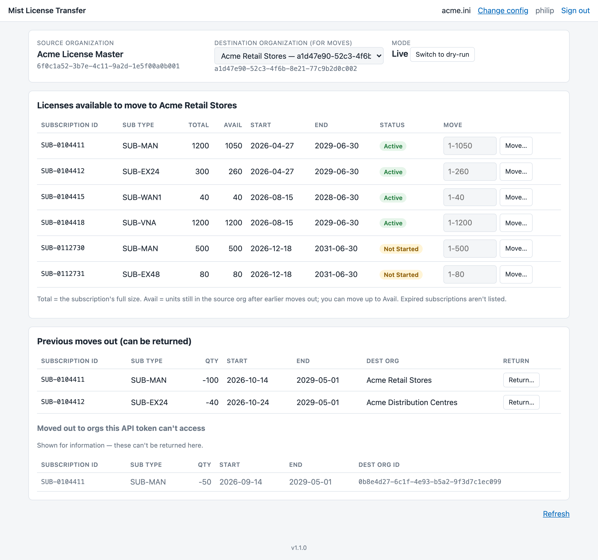

# Mist License Transfer (web)

A small web app for moving Juniper Mist subscription licenses from one
organisation to another — or undoing a move made earlier. It is the web
edition of the [Mist License Transfer CLI](https://github.com/keeleyp/mist-license-transfer)
and uses the same `.ini` config files, so it can run on a Raspberry Pi
and be used from any browser on your network.

- Sign in with your own user name and password. Each user is tied to one or
  more config files, so they only see the orgs they're meant to.
- See the source org, choose a destination org, and view the license table:
  **Total**, **Avail** and **Status** (Active / Not Started).
- **Move** a quantity (up to Avail) to the destination, or **Return** a
  previous move. Both go through a confirmation page first.
- Dry-run mode walks through the same steps but never changes anything.
- Every move and return (including dry-runs and failures) is written to
  `license_transfer_changes.log`, with the user who made it.

**Using the app:** see the [User Guide](docs/USER_GUIDE.md), which has screenshots. It's also available as a [PDF](docs/USER_GUIDE.pdf).



## Requirements

- Python 3.9+ (Raspberry Pi OS Bookworm ships 3.11)
- A Mist API token per config, for a user with access to the source org
  and every destination org in that config

## Quick start (any machine)

```bash
python3 -m venv .venv
.venv/bin/pip install -r requirements.txt
cp mist_license_transfer.ini.example customer-a.ini   # fill in token + org IDs
cp web.conf.example web.conf                          # add your users
.venv/bin/python3 app.py --hash-password              # paste the output into web.conf
.venv/bin/python3 app.py
```

Then open `http://<host>:5030` and sign in.

## Config files (`*.ini`)

Same format as the CLI. You can put any number of them in the app folder,
e.g. one per customer:

```ini
[mist]
base_url = https://api.eu.mist.com/api/v1
api_token = YOUR_API_TOKEN

[source]
org_id = YOUR_SOURCE_ORG_ID

[destinations]
org_ids = YOUR_DEST_ORG_ID_1, YOUR_DEST_ORG_ID_2
```

- `base_url` depends on the Mist cloud: `https://api.mist.com/api/v1` (US),
  `https://api.eu.mist.com/api/v1` (EU), `https://api.gc1.mist.com/api/v1`
  (GovCloud), and so on.
- With more than one destination org, the page has a drop-down to pick one.
- If the token is invalid (401) or can't access the source org (403/404),
  the page says so and goes no further.
- Your existing CLI `.ini` files work as they are: copy them into this
  folder.

### Behind a TLS-inspecting proxy (e.g. Zscaler)

Add the optional `[network]` section, exactly as for the CLI:

```ini
[network]
ca_bundle = /path/to/zscaler-root-ca.pem
verify_ssl = true
http_proxy =
https_proxy =
```

`ca_bundle` is a PEM file with the proxy's root CA. `verify_ssl = false`
turns certificate checks off entirely (last resort only). With no
`[network]` section, the normal system defaults are used.

## Users (`web.conf`)

`web.conf` holds the web settings and one `[user NAME]` section per login:

```ini
[web]
host = 0.0.0.0
port = 5030
session_minutes = 60

[user philip]
password_hash = scrypt:32768:8:1$...
configs = customer-a.ini, customer-b.ini
dry_run_only = false

[user trainee]
password_hash = scrypt:32768:8:1$...
configs = customer-a.ini
dry_run_only = true
```

- `password_hash`: run `python3 app.py --hash-password`, type the password
  twice, and paste the line it prints. Plain-text passwords aren't stored.
- `configs`: the `.ini` files this user may use (comma-separated), or `*`
  for all of them. A user with one config goes straight to it; a user with
  several picks one (and can switch with **Change config**).
- `dry_run_only = true`: the user can only simulate moves and returns.
- After five wrong passwords for a user name from the same address, sign-in
  is locked for 15 minutes.
- Restart the app after editing `web.conf`. The app won't start if
  `web.conf` is missing, has no users, or names a config file that doesn't
  exist. It tells you what's wrong.

`web.conf`, every `*.ini` and the change log are gitignored. Only the
`.example` templates are tracked.

## Options

| Flag | Purpose |
|---|---|
| `--dry-run` | Never call the Mist API to make changes, whatever users choose |
| `--hash-password` | Prompt for a password and print a `password_hash` line |
| `--web-conf <path>` | Use a different users/settings file |
| `--host`, `--port` | Override `[web] host` / `port` |

Without `--dry-run`, each user can switch between **Live** and **Dry-run**
on the page (unless their login is `dry_run_only`).

## Install on a Raspberry Pi

Written for Raspberry Pi OS (Bookworm or later). The commands fill in your
own user name and home folder, whatever your Pi user is called. Port
**5030** is used so it doesn't clash with the other home apps (5000, 5001,
5010, 5020, 5050).

### 1. Install git and Python tools

```bash
sudo apt update
sudo apt install -y git python3-venv
```

### 2. Clone the repo

```bash
cd ~
git clone https://github.com/keeleyp/mist-license-transfer-web.git
cd mist-license-transfer-web
```

### 3. Create the virtual environment

```bash
python3 -m venv .venv
.venv/bin/pip install -r requirements.txt
```

### 4. Add your configs and users

Copy your `.ini` files over from your Mac (run this on the Mac):

```bash
scp customer-a.ini <pi-user>@<pi-ip>:mist-license-transfer-web/
```

Then on the Pi:

```bash
chmod 600 *.ini
cp web.conf.example web.conf
.venv/bin/python3 app.py --hash-password
nano web.conf
chmod 600 web.conf
```

### 5. Try it

```bash
.venv/bin/python3 app.py --dry-run
```

Open `http://<pi-ip>:5030`, sign in, and check the license table. Press
`Ctrl+C` to stop.

### 6. Start on boot (systemd)

The unit file in `deploy/` uses `pi` / `/home/pi` as placeholders; this
installs it with your actual user name and home folder:

```bash
sed "s|/home/pi|$HOME|g; s|User=pi|User=$USER|" deploy/mist-license-transfer-web.service \
    | sudo tee /etc/systemd/system/mist-license-transfer-web.service >/dev/null
sudo systemctl daemon-reload
sudo systemctl enable --now mist-license-transfer-web
```

Check it's running and view the logs:

```bash
sudo systemctl status mist-license-transfer-web
sudo journalctl -u mist-license-transfer-web -f
```

If `status` shows `217/USER` or `200/CHDIR`, the unit was copied without
the substitution above. Re-run the `sed ... | sudo tee` command. After
editing `web.conf` or adding a config:

```bash
sudo systemctl restart mist-license-transfer-web
```

To run the service in dry-run mode only, add `--dry-run` to the end of the
`ExecStart` line.

### Finding the Pi's address

On the Pi, run `hostname -I`. Most home networks also resolve
`http://<pi-hostname>.local:5030`.

## Security notes

- This app moves real subscription allocation between orgs. Read each
  confirmation page before you confirm.
- The app serves plain HTTP. Use it on your home network only, and don't
  port-forward it to the internet. For remote use, connect through a VPN
  (e.g. WireGuard or Tailscale) or put an HTTPS reverse proxy in front.
- Restarting the app signs everyone out.

## Tests

The tests use a fake Mist API and never contact Mist:

```bash
python3 -m unittest discover -s tests
```
