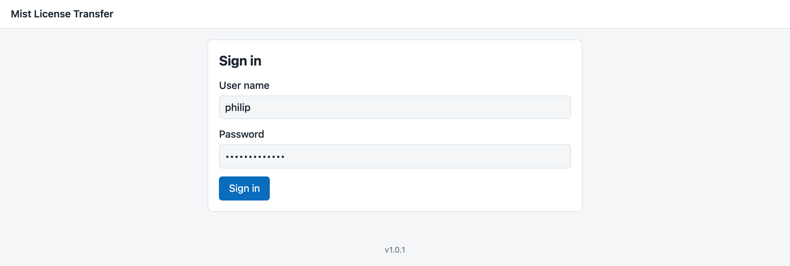
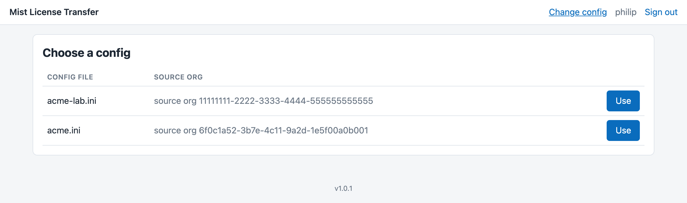
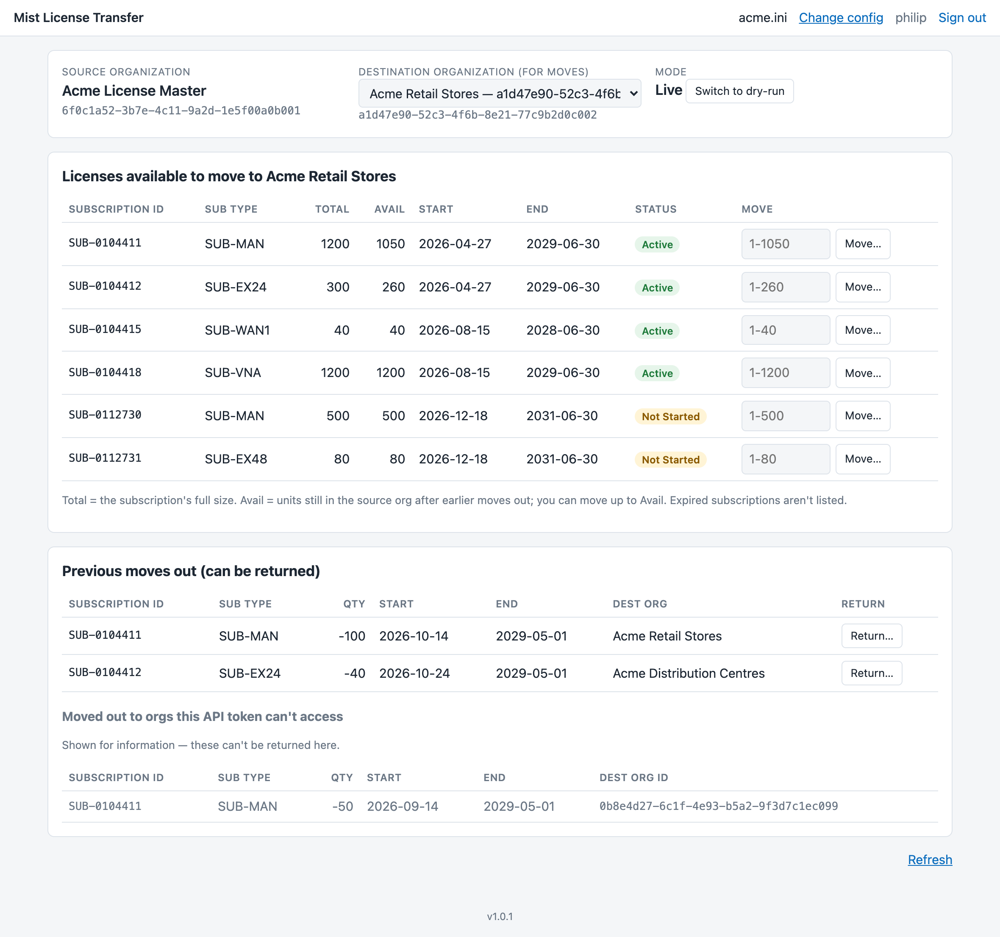
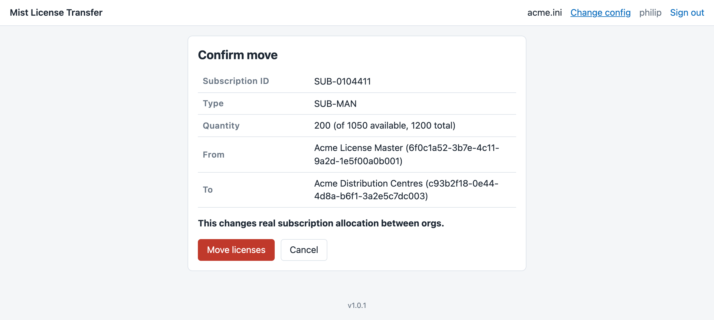
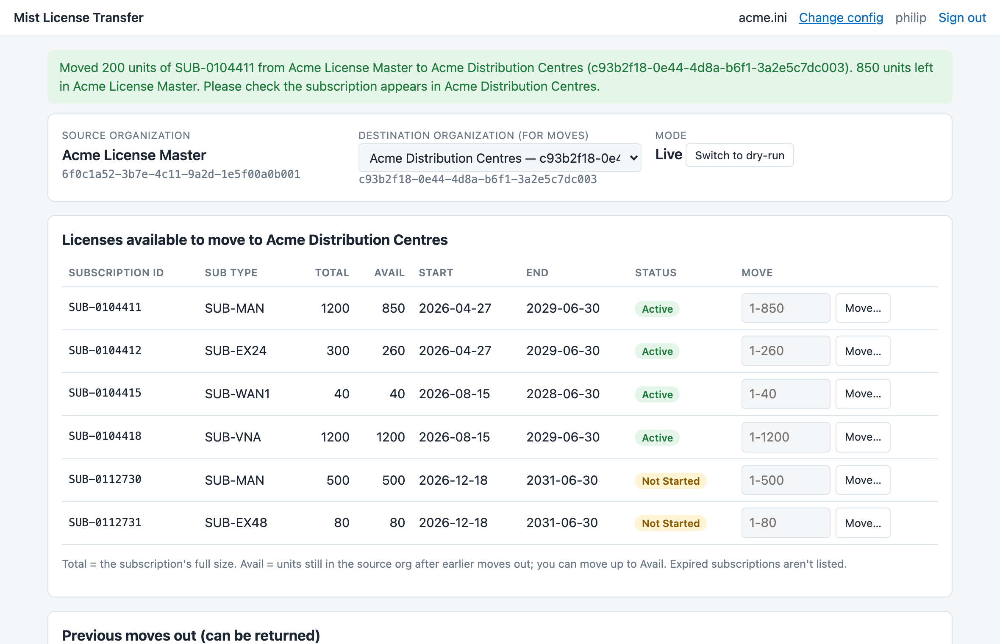
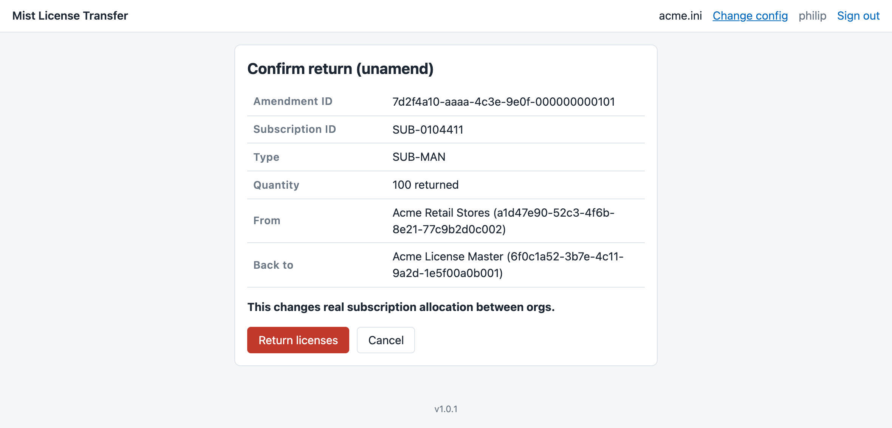
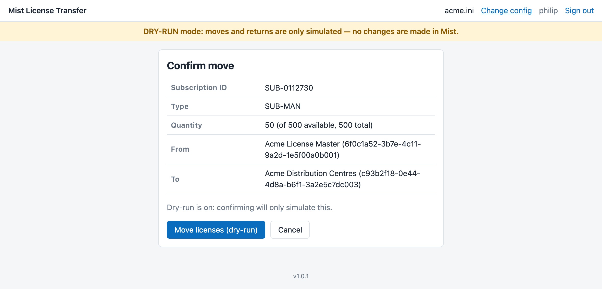
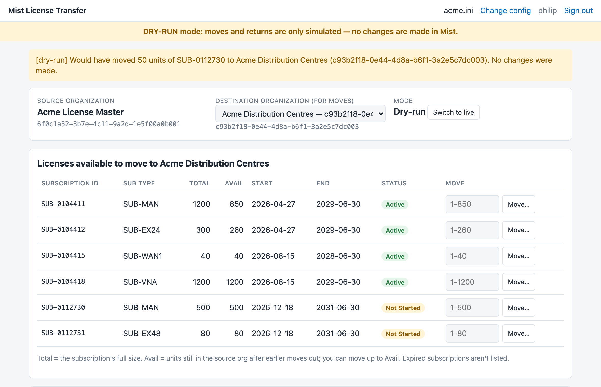
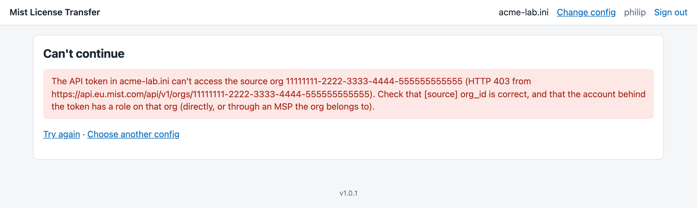

# User Guide — Mist License Transfer (web)

This guide walks through using the web app day to day: signing in, finding
the license you want, moving capacity to another org, and undoing a move.
Setting the app up (config files, users, the Raspberry Pi service) is
covered in the [README](../README.md).

> The screenshots use made-up demo orgs ("Acme License Master" and friends)
> and a simulated Mist API, so no real customer data appears here.

**Contents**

1. [Signing in](#1-signing-in)
2. [Choosing a config](#2-choosing-a-config)
3. [The main page](#3-the-main-page)
4. [Moving licenses to another org](#4-moving-licenses-to-another-org)
5. [Returning a previous move](#5-returning-a-previous-move)
6. [Dry-run mode](#6-dry-run-mode)
7. [When something goes wrong](#7-when-something-goes-wrong)
8. [Quick reference](#8-quick-reference)

---

## 1. Signing in

Open the app in a browser — on the Pi that's `http://<pi-address>:5030` —
and sign in with the user name and password your admin set up for you.

- After five wrong passwords in a row, sign-in for that user name is locked
  for 15 minutes.
- You're signed out automatically after an hour without using the page (the
  admin can change this), and whenever the app is restarted.
- Use **Sign out** (top right) when you've finished, especially on a shared
  computer.

## 2. Choosing a config

Each config file is one set of orgs: an API token, a **source org** that
licenses are moved out of, and the **destination orgs** they can be moved
to. Your login is tied to one or more of them.

- With **one** config you go straight to the main page.
- With **several** you pick one first:

The config in use is always shown in the top bar. Click **Change config**
to switch to another one.

## 3. The main page

**Top panel**

| Field | Meaning |
|---|---|
| Source organization | The org licenses are moved *out of* (and returned *to*). Fixed by the config. |
| Destination organization | Where a **Move** sends licenses. Pick from the drop-down if the config lists more than one. |
| Mode | **Live** makes real changes; **Dry-run** only simulates them (see [section 6](#6-dry-run-mode)). |

**Licenses available to move**

| Column | Meaning |
|---|---|
| Subscription ID / Sub type | The Mist subscription, e.g. `SUB-MAN`, `SUB-EX24`. |
| Total | The subscription's full size. |
| Avail | Units still in the source org after earlier moves out — the most you can move. |
| Start / End | Subscription term. |
| Status | **Active** (started) or **Not Started** (starts in the future — it can still be moved ahead of time). |

Expired subscriptions, and subscriptions with nothing left (Avail 0), are
not listed.

**Previous moves out (can be returned)**

Every unexpired move out of the source org, whichever org it went to, with
a **Return…** button. **Qty** is shown as a negative number (units that
left the source org).

Moves to orgs that this config's API token can't see are listed separately
underneath, greyed out, for information only — they can't be returned from
here. Ask someone with access to that org to check them.

Click **Refresh** (bottom right) or reload the page at any time to re-read
everything from Mist.

## 4. Moving licenses to another org

1. Check the **Destination organization** is the org you want — change it
   with the drop-down if needed.
2. In the row for the subscription, type the number of units into the
   **Move** box (1 up to Avail) and click **Move…**.
3. A confirmation page shows exactly what will happen. Read it carefully:

   

4. Click **Move licenses** to go ahead, or **Cancel** to go back without
   changing anything.

The main page then shows the result and the updated Avail:

The move also appears under **Previous moves out**, so it can be returned
later. It's worth checking in the Mist portal that the subscription shows
up in the destination org.

Good to know:

- The license list is re-read from Mist both when the confirmation page
  opens and again when you confirm. If someone else has moved units in the
  meantime and there are no longer enough, nothing is changed and you're
  told why.
- Each confirmation page can only be used once — refreshing or pressing
  Back and submitting again won't repeat the move.

## 5. Returning a previous move

Returning (an "unamend" in Mist terms) puts the units from a previous move
back into the source org.

1. Under **Previous moves out**, click **Return…** on the move you want to
   undo. You don't need to change the destination drop-down first — every
   move is listed, whichever org it went to.
2. Check the confirmation page — it shows the org the units come **From**
   and the source org they go **Back to**:

   

3. Click **Return licenses**, or **Cancel**.

A return always gives back the whole move — to return only part of it,
return the whole move and then move the smaller quantity again.

## 6. Dry-run mode

Dry-run lets you walk through a move or return without changing anything
in Mist — useful for training, or for checking what a change would look
like.

- Click **Switch to dry-run** in the Mode panel. A yellow banner across the
  top shows it's on.
- Moves and returns go through the same confirmation page, with the button
  labelled **(dry-run)**:

  

- Confirming shows what *would* have happened; the table doesn't change:

  

- Click **Switch to live** to go back to making real changes.

If the Mode panel says **Dry-run — fixed for this login**, your account (or
the whole app) is set to dry-run only by the admin and can't be switched
to live.

## 7. When something goes wrong

**The page says "Can't continue"** — the app couldn't read the source org,
so it stops before showing anything:

| Message mentions | What it means | What to do |
|---|---|---|
| *rejected as invalid* (HTTP 401) | The API token in the config has been deleted or has expired. | Ask the admin to create a new token in Mist and update the config. |
| *can't access the source org* (HTTP 403/404) | The token's account has no role on the source org, or the org ID is wrong. | Ask the admin to check the config's source org ID and the account's access. |
| *TLS certificate verification failed* | A proxy (e.g. Zscaler) is intercepting the connection. | The admin sets `ca_bundle` in the config's `[network]` section. |
| *Could not connect* / *timed out* | The app can't reach the Mist cloud. | Check the network, then **Try again**. |

**A red message after Move/Return** — the change was not made. The message
says why (for example, the quantity is more than is now available, or Mist
rejected the request). Fix the cause and try again.

**"That confirmation has expired or was already used"** — you pressed Back
or refreshed a confirmation page. Nothing was changed; start the move again
from the main page.

**Wrong password / locked out** — after five failed attempts, wait 15
minutes. If you've forgotten your password, ask the admin to set a new one.

## 8. Quick reference

| I want to… | Do this |
|---|---|
| Move licenses | Pick destination → type quantity → **Move…** → **Move licenses** |
| Undo a move | **Return…** on the move → **Return licenses** |
| Try without changing anything | **Switch to dry-run**, then move/return as normal |
| Use a different set of orgs | **Change config** (top bar) |
| See the latest from Mist | **Refresh** or reload the page |
| Finish | **Sign out** |

Every move and return — including dry-runs and failures — is recorded with
your user name in the app's change log, which the admin can check on the
server.
